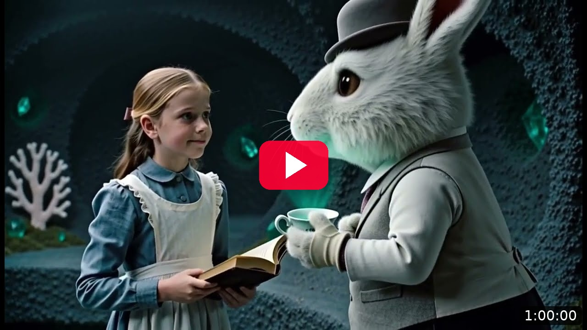
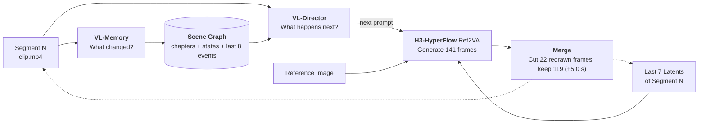

<p align="center">
  
</p>

<p align="center">
  <a href="https://huggingface.co/videorebirth/hyperflow"></a>
  <a href="https://www.videorebirth.com/lp/hyperflow-infinity"></a>
</p>

**HyperFlow-Infinity** is [Video Rebirth](https://www.videorebirth.com/)'s minimal agent harness that empowers [HyperFlow](https://huggingface.co/videorebirth/hyperflow) for infinite video generation.


<a id="intro"></a>

## Introduction

Give HyperFlow Infinity a story seed — characters and a setting. It recursively generates a segment, watches it, updates its memory, decides what happens next, and keeps going in a self-play loop.

1. **HyperFlow as Agent** — turns [MiniMax-H3](https://huggingface.co/MiniMaxAI/MiniMax-H3) + [HyperFlow](https://huggingface.co/videorebirth/hyperflow) into an agent, with no additional model introduced.
2. **DiT + VL for Self-play** — the DiT generates, while the VL watches, remembers, and directs, enabling recursive generation.
3. **Open-ended narrative plot** — compared with existing infinite generation such as [Echo-Infinity](https://echo-team-joy-future-academy-jd.github.io/Echo-Infinity/), ours develops a richer plot, and the ending stays open: self-play never presets where the story ends.
4. **Memory for consistency** — a scene graph models the scenes and characters and serves as the visual memory, keeping them consistent across the whole film.

<table>
<tr><th>Example</th><th>Echo-Infinity<br>(5x speed)</th><th>HyperFlow-Infinity<br>(5x speed)</th></tr>
<tr>
<td>Paul — a bearded traveler in the ancient Mediterranean countryside who meets a lost boy by the roadside</td>
<td><a href="assets/01_roadside_companion_echo.mp4"></a></td>
<td><a href="assets/01_roadside_companion.mp4"></a></td>
</tr>
<tr><td>Storyline</td><td>Predefined, Limited scene</td><td>Open-ended, Narrative</td></tr>
</table>

**1-hour generation — Alice in Wonderland: An Endless Wander**

HyperFlow-Infinity recursively generated 1 hour of 1344x768 film, with the same Alice throughout.

<p align="center"><a href="https://www.youtube.com/watch?v=UsEFS0oji4Q"></a></p>

<a id="install"></a>

## Install

**Requirements**

- **GPU:** ≥ 4 NVIDIA GPUs (≥ 3 with OpenRouter, see [VL via OpenRouter](#openrouter)); only H200 141 GB tested
- **System:** Linux, Python ≥3.10, `ffmpeg` / `ffprobe` on `PATH`

**Install**

```bash
git clone https://github.com/Video-Rebirth/hyperflow-infinity.git hyperflow-infinity
cd hyperflow-infinity
python3 -m venv .venv && source .venv/bin/activate
pip install -r requirements.txt   # pinned versions, CUDA 12.9 wheels
pip install -e .
```

> If your CUDA is not 12.9, install the matching `torch==2.11.0` build first.

**Download weights**

```bash
hf download MiniMaxAI/MiniMax-H3 --revision 83db0c0efe6ef9824e0e194be110346c0a9542ed --local-dir /models/MiniMax-H3
hf download videorebirth/hyperflow minimax_h3_hyperflow_8step_v1.0.safetensors --local-dir /models/hyperflow
```


<a id="quick-start"></a>

## Quick Start

**Step 1 — start the local Qwen service (skip with OpenRouter)**:

```bash
CUDA_VISIBLE_DEVICES=7 hyperflow-infinity-qwen --model /models/MiniMax-H3/text_encoder --port 30050
# ready when: curl http://127.0.0.1:30050/  →  "status": "ready"  (< 1 min)
```

For a faster Qwen, see [SGLang Backend](#sglang).

**Step 2 — create a run directory (GPUs listed here must exclude the Qwen GPU).**

Segment 1 needs an opening image so it can run through the Ref2V pipeline like every later segment. Qwen-Image draws that placeholder image when you do not provide a reference; with your own reference image (or video), the 54 GB Qwen-Image download is not needed. If you have no reference image, add `--qwen-image-dir /models/Qwen-Image-2512` instead of `--identity-image`:

```bash
# With your own reference image — for example, the Alice seed in this repo
hyperflow-infinity init --run-dir runs/alice --config configs/alice.json \
  --h3-dir /models/MiniMax-H3 --hyperflow-weights /models/hyperflow/minimax_h3_hyperflow_8step_v1.0.safetensors \
  --identity-image configs/alice.png \
  --generation-gpus 0,1,2,3,4,5 --conditioning-gpu 6 --qwen-url http://127.0.0.1:30050

# Without a reference image — Qwen-Image draws the opening image
hyperflow-infinity init --run-dir runs/alice --config configs/alice.json \
  --h3-dir /models/MiniMax-H3 --hyperflow-weights /models/hyperflow/minimax_h3_hyperflow_8step_v1.0.safetensors \
  --qwen-image-dir /models/Qwen-Image-2512 \
  --generation-gpus 0,1,2,3,4,5 --conditioning-gpu 6 --qwen-url http://127.0.0.1:30050
```

**Step 3 — generate (`--resume` is required every time, including the first)**:

```bash
hyperflow-infinity launch --run-dir runs/alice --resume
```

**Step 4 — Monitor**: open `runs/alice/index.html` or `runs/alice/previews/C00NN/film.mp4`.

- Pause after current segment — `hyperflow-infinity pause --run-dir runs/alice` (or Ctrl-C)
- Continue — Step 3 again
- Status — `hyperflow-infinity status --run-dir runs/alice`

### Customize your own story

Customize `configs/alice.json`: edit the `seed_story`, `visual_style` and `director_guidance` fields:

```python
CONFIG = {
    "seed_story": {
        "inspiration": "Lewis Carroll's Alice's Adventures in Wonderland / 爱丽丝漫游仙境; a starting inspiration, not a prescribed retelling or future outline.",  # starting inspiration only — not a retelling
        "world": "A Victorian English riverside opening into a whimsical dreamlike world. Curious talking animals, playful changes of scale and surprising physical rules may emerge coherently through visible events. No modern objects. Wonder, wit and curiosity rather than horror.",  # time, place and rules of the world
        "initial_situation": "Alice is sitting beside a quiet river on a warm afternoon when an unusually dressed white rabbit catches her attention. She chooses what to do next. No later milestones, encounters or ending are prescribed.",  # where the film starts; keep later events out
        "characters": [
            {
                "id": "alice",  # character id, referenced by identity.character_id
                "name": "Alice / 爱丽丝",  # display name
                "aliases": [
                    "Alice",
                    "爱丽丝",
                ],  # other names the character may be called
                "identity_text": "Alice is portrayed by a real English child actress, approximately ten years old, with natural facial proportions, fair skin with subtle freckles, shoulder-length dark blonde hair held with a simple dark ribbon, a modest pale blue Victorian cotton dress, white pinafore, white stockings and practical dark shoes. Natural expressive human face and age-appropriate proportions, never an illustrated or animated character. Keep the same face, age, hair and wardrobe across segments.",  # face, hair and clothes — kept consistent across segments
            },
        ],  # the main character(s)
    },  # the story seed: world, opening and characters
    "visual_style": "Photorealistic live-action period fantasy photographed with real human actors on physical sets and real English countryside locations. Alice is a real child actress with natural skin texture, realistic facial proportions, individual hair strands, physically woven Victorian clothes, natural human movement and lens depth of field. Soft natural daylight, realistic shadows and tangible materials. A literary Alice in Wonderland adaptation, not an animated adaptation. No cartoon, anime, cel shading, illustration, outlines, stylized doll faces or game-render appearance. Fantasy events remain possible but are depicted as physically filmed cinematic visual effects. Family-friendly, age-appropriate costumes. No on-screen text.",  # look, lighting and sound, sent with every prompt
    "director_guidance": "make the unfolding story richer and more imaginative. Alice in Wonderland is only the starting seed, not a plot to reenact. Develop fresh causal events from what the video actually shows. Across successive segments, vary the dramatic purpose: discovery, a concrete obstacle, an inventive use of an object, an encounter or interaction, a difficult choice, a reversal, or an earned payoff. These are optional possibilities, not a checklist or scheduled outline. Let curiosity, resourcefulness, wonder, relief and occasional humor coexist with danger; do not default to fear and scanning. New people, animals or environmental surprises may enter naturally when compatible with the established world; introduce new characters through the existing new_characters schema. Choose one legible, achievable action and its visible result for this short segment. Connect surprises to existing clues or consequences instead of unrelated spectacle. Develop or pay off a clue rather than repeatedly rediscovering it. If recent intentions already repeat a type of action, such as marking another root or merely preparing to stand, choose a materially different consequence; changing the ordinal number, camera angle, emotion or scene label does not create a new event. Keep spatial continuity, established identities and observed possessions. Do not claim a past action happened just because it was requested, or call an experience first when the retained history shows otherwise. Continue open-ended; do not impose a complete future outline, a forced ending, or a new genre. Output only the existing Director JSON schema, not alternative plans or commentary.",  # your creative direction, added to every VL-Director request
    "identity": {
        "character_id": "alice",  # which character the reference image shows
        "binding": "Alice is the same person as <Picture 1>. Preserve her facial identity from this image; use it as an identity reference, not as the current scene or pose.",  # the sentence telling the model the character is <Picture 1>
    },  # how the reference image binds to the character
    "width": 1344,  # output width in px (864 = 480p, 1344 = 768p)
    "height": 768,  # output height in px (480 = 480p, 768 = 768p)
    "seed": 30109001,  # base random seed for generation
    "max_role_attempts": 3,  # retries when a VL answer fails validation
    "beat_history": 12,  # recent beats the VL-Director must not repeat
    "max_scene_segments": 8,  # segments a scene may last before it must change
    "memory_recent_events": 8,  # recent events kept in the VL view of the scene graph
    "memory_compact_trigger": 22,  # fold old events into a chapter above this count
    "memory_fold_count": 10,  # how many oldest events are folded at a time
    "preview_every_chunks": 5,  # reassemble the film every N segments
    "hyperflow_weights_sha256": "4d7dec1363ebcb9fd63117621b65f8bd19fecacf7ba41f38dd098be363d3972d",  # SHA256 the HyperFlow weights are checked against at launch
}
```


<a id="optional"></a>

### Optional

<a id="openrouter"></a>

#### VL-Encoder via OpenRouter

Use a hosted Qwen instead of the local service: **no Qwen GPU needed, and skip Step 1 above.**

```bash
read -rs -p "OpenRouter API key: " OPENROUTER_API_KEY; echo; export OPENROUTER_API_KEY

hyperflow-infinity init --run-dir runs/alice-api --config configs/alice.json \
  --h3-dir /models/MiniMax-H3 --hyperflow-weights /models/hyperflow/minimax_h3_hyperflow_8step_v1.0.safetensors \
  --qwen-image-dir /models/Qwen-Image-2512 \
  --generation-gpus 0,1,2,3,4,5 --conditioning-gpu 6 \
  --vlm-provider openrouter --openrouter-model qwen/qwen3.8-flash
hyperflow-infinity launch --run-dir runs/alice-api --resume
```

Supported models:

- `qwen/qwen3.8-flash` (native video)
- `qwen/qwen3.5-flash-02-23` (native video)
- `qwen/qwen3-vl-32b-instruct` (2 fps frames, no audio)

The API key is read from the environment at `launch` and never written to the run directory.

<a id="opening"></a>

#### Custom Reference Image

By default Qwen-Image draws the opening image from the seed. You can also provide your own at `init`:

This image is a placeholder that lets segment 1 run through H3's Ref2V pipeline as well, so the whole film uses a single Ref2V workflow end to end — no checkpoint switching between segments. (Starting from text-to-video is also possible, but would require switching pipelines.)

- `--identity-image face.png` — your image opens the film and anchors the character in all later segments
- `--opening-reference scene.png` — segment 1 is generated from your image
- `--opening-reference clip.mp4` — segment 1 is generated from your video (1–14 s, picture only)

Optional — if Qwen-Image should draw the opening image instead (54 GB; skip if you provide your own reference image or video):

```bash
hf download Qwen/Qwen-Image-2512 --local-dir /models/Qwen-Image-2512
```

<a id="branch"></a>

#### Branch a Run

Pause a run, then branch from any segment with a new direction. The source run is not modified.

```bash
hyperflow-infinity branch --source-run runs/alice --after-segment C0028 --run-dir runs/alice-branch \
  --guidance "Explore the cave instead of following the shore." --new-segments 12
hyperflow-infinity launch --run-dir runs/alice-branch --resume
```

<a id="sglang"></a>

#### SGLang Backend

Serve Qwen with SGLang instead of HF `generate`: VL-Director + VL-Memory drop from ~45 s to ~14 s per segment (see [Performance](#performance)). SGLang is not in `requirements.txt`; install a build compatible with `torch==2.11.0`, then start Step 1 with `--backend sglang`:

```bash
CUDA_VISIBLE_DEVICES=7 hyperflow-infinity-qwen --model /models/MiniMax-H3/text_encoder --backend sglang --port 30050
```

<a id="fa3"></a>

#### FlashAttention-3

Install it, then enable it by passing `--attention-backend fa3` at `init` (it is stored in the run and used by every later `launch`):

```bash
pip install "kernels>=0.12"

hyperflow-infinity init --run-dir runs/alice-fa3 --config configs/alice.json \
  --h3-dir /models/MiniMax-H3 --hyperflow-weights /models/hyperflow/minimax_h3_hyperflow_8step_v1.0.safetensors \
  --identity-image configs/alice.png \
  --generation-gpus 0,1,2,3,4,5 --conditioning-gpu 6 --qwen-url http://127.0.0.1:30050 \
  --attention-backend fa3
hyperflow-infinity launch --run-dir runs/alice-fa3 --resume
```

Without `--attention-backend`, the default is PyTorch SDPA (`sdpa`). FA3 is recommended at 768p (set `width` / `height` to 1344 / 768 in the config, as in `configs/alice.json`).


<a id="how-it-works"></a>

## How It Works

**VL-Memory** watches the last segment, **VL-Director** writes the next prompt, **H3-HyperFlow** generates it — then the loop repeats.



- **VL-Memory** — records only what changed into a **scene graph**; old events fold into chapter summaries.
- **VL-Director** — reads the **scene graph** and writes the next prompt; repetitive answers are rejected and retried.
- **H3-HyperFlow** — the H3 DiT with the 8-step HyperFlow LoRA; generates from the reference image plus the last 7 latents of the previous segment, for a seamless continuation.
- **Merge** — cuts the 22 redrawn frames and keeps 119 new frames (+5.0 s).


<a id="performance"></a>

## Performance

One 8× H200 (141 GB) node, 768p (1344×768), HyperFlow 8 steps, FlashAttention-3, `configs/alice.json`. GPUs 0–5 generate, GPU 6 conditions, GPU 7 runs Qwen. Median time per 5 s segment:

| Qwen backend | VL-Director | VL-Memory | H3-HyperFlow | Total per 5 s segment |
|---|---|---|---|---|
| Local HF (`--backend hf`, default) | 26.0 s | 18.8 s | 31.8 s | **78.1 s** |
| Local SGLang (`--backend sglang`) | 8.7 s | 5.1 s | 32.2 s | **49.2 s** |

Totals include ~2.5 s to cut frames. Without FA3 (default `sdpa`), H3-HyperFlow takes 34.1 s per segment. One-time startup: ~30 s to build the H3 pipeline, then ~2.5 min for segment 1 (345 frames).

<a id="acknowledgements"></a>

## Acknowledgements

- **[MiniMax-H3](https://huggingface.co/MiniMaxAI/MiniMax-H3)** ([GitHub](https://github.com/MiniMax-AI/MiniMax-H3)): the base model, VAEs, conditioner and official workflows.
- **[HyperFlow](https://huggingface.co/videorebirth/hyperflow)** ([GitHub](https://github.com/Video-Rebirth/hyperflow)): the 8-step LoRA that makes each segment fast enough for the recursive loop.
- **[Echo-Infinity](https://echo-team-joy-future-academy-jd.github.io/Echo-Infinity/)**: Open-source infinite video generation.


If you use HyperFlow Infinity in your work, please cite it as follows:

```bibtex
@misc{videorebirth2026hyperflowinfinity,
      title={HyperFlow Infinity: Infinity video generation with {MiniMax-H3} and {HyperFlow}},
      author={Video Rebirth},
      year={2026},
      url={https://github.com/Video-Rebirth/hyperflow-infinity},
}
```


<a id="license"></a>

## License

Code: [Apache-2.0](LICENSE); the schedule, blocks and Sol-Attn processor derive from or rework diffusers code, see [`THIRD_PARTY_NOTICES.md`](https://github.com/Video-Rebirth/hyperflow/blob/main/THIRD_PARTY_NOTICES.md). The LoRA weights are a Model Derivative of MiniMax-H3 and are distributed on [their Hugging Face repo](https://huggingface.co/videorebirth/hyperflow) under the [MiniMax H3 Community License Agreement](https://huggingface.co/videorebirth/hyperflow/blob/main/LICENSE). That Agreement, not this repository's license, governs any use of the weights: it excludes the EU, UK, South Korea and the US absent MiniMax's authorization and carries an Acceptable Use Policy. HyperFlow is developed by Video Rebirth and is not affiliated with or endorsed by MiniMax.
